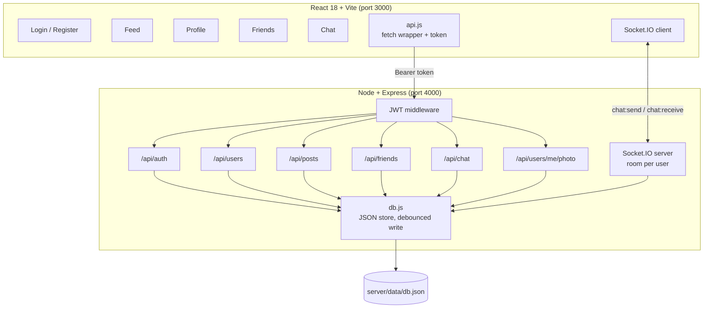

# ConnectHub

**A full-stack social network — auth, profiles, feed, friendships and real-time chat — built from scratch without a framework or a managed backend.**

<p>
  
  
  
  
  
  
</p>

<!--
  ⬜ TODO: add a screenshot here. This is the single biggest improvement you can
  make to this README. Drop a PNG at docs/feed.png and uncomment the line below.

  
-->

Every part of this is hand-rolled: password hashing, token issuing, file uploads,
the data layer, and the WebSocket transport. No Firebase, no Supabase, no
Passport, no ORM. That was the point — I wanted to know what the frameworks
actually do before I let them do it for me.

---

## Contents

- [Features](#features)
- [Architecture](#architecture)
- [Tech stack](#tech-stack)
- [Quick start](#quick-start)
- [API reference](#api-reference)
- [Data model](#data-model)
- [Design decisions](#design-decisions)
- [Known limitations](#known-limitations)
- [Roadmap](#roadmap)
- [License](#license)

---

## Features

| Area | What it does |
|---|---|
| 🔐 **Auth** | Register and log in with email + password. Passwords hashed with bcrypt, sessions carried by a 30-day JWT |
| 👤 **Profiles** | Editable name and bio; profile photo upload via multipart form (multer), served from `/uploads` |
| 📰 **Feed** | Create posts; the feed is scoped to you and your accepted friends |
| 👍 **Likes** | Like and unlike posts, with counts resolved server-side |
| 💬 **Comments** | Thread comments onto any post |
| 🤝 **Friendships** | Send, accept and decline requests; stranger suggestions; unfriend |
| ⚡ **Chat** | Real-time one-to-one messaging over Socket.IO, with per-user rooms and conversation history |
| 🚪 **Route guards** | Every page is wrapped in an auth check; unauthenticated visits redirect to `/login` |

## Architecture



The API is a plain Express app mounted under `/api`, with one router file per
domain. Everything except `/api/auth/*` passes through the same JWT middleware,
which verifies the token once and attaches `req.userId` — so no route has to
re-implement authentication.

Real-time chat is deliberately separate from REST. The socket handshake carries
the same JWT; on connection the socket joins a room named `user_{id}`, and a
message is delivered by emitting to the recipient's room. That means one user
with three tabs open gets the message in all three, with no bookkeeping.

## Tech stack

| Layer | Choice | Why |
|---|---|---|
| Frontend | React 18 + Vite | Fast HMR while iterating on UI |
| Routing | React Router 6 | Auth-guarded routes |
| Backend | Node.js + Express 4 | One router per domain, easy to reason about |
| Auth | JWT (30d) + bcryptjs | Stateless sessions, no server-side session store |
| Uploads | multer | Multipart handling without a cloud dependency |
| Realtime | Socket.IO 4 | Automatic reconnection and room semantics |
| Storage | JSON file | Zero setup; single-user-scale by design |

## Quick start

Requires **Node 18+**.

```bash
git clone https://github.com/dominicnkutha1-netize/ConnectHub.git
cd ConnectHub
```

**1. Generate the JWT secret.** The server refuses to start without it, and it's
gitignored on purpose — so you must create it once:

```bash
# from the repo root
node -e "require('fs').writeFileSync('server/secret.js', 'module.exports = ' + JSON.stringify(require('crypto').randomBytes(32).toString('hex')) + ';')"
```

**2. Start the API** (port 4000):

```bash
cd server
npm install
npm start
```

**3. Start the client** (port 3000):

```bash
cd ../client
npm install
npm run dev
```

Open <http://localhost:3000>, register an account, then open a **private window**
and register a second account. Send a friend request from one, accept it in the
other, and the chat between them will update live.

Health check: `curl http://localhost:4000/api/health` → `{"ok":true}`

## API reference

All routes are prefixed `/api` and require `Authorization: Bearer <token>`
except the auth routes.

**Auth** — `/api/auth`
| Method | Path | Purpose |
|---|---|---|
| POST | `/register` | Create an account, returns `{ token, user }` |
| POST | `/login` | Authenticate, returns `{ token, user }` |

**Users** — `/api/users`
| Method | Path | Purpose |
|---|---|---|
| GET | `/me` | Current user from the token |
| GET | `/:id` | Public view of another user |
| PUT | `/me` | Update name / bio |
| POST | `/me/photo` | Upload a profile photo (`multipart/form-data`, field `photo`) |

**Posts** — `/api/posts`
| Method | Path | Purpose |
|---|---|---|
| GET | `/` | Feed for the current user (self + friends) |
| GET | `/user/:id` | Posts by one user |
| POST | `/` | Create a post |
| POST | `/:id/like` | Toggle like |
| POST | `/:id/comment` | Add a comment |
| DELETE | `/:id` | Delete own post |

**Friends** — `/api/friends`
| Method | Path | Purpose |
|---|---|---|
| GET | `/` | Accepted friends |
| GET | `/requests` | Incoming friend requests |
| GET | `/suggestions` | Users you're not connected to |
| POST | `/:id/request` | Send a request |
| POST | `/:id/accept` | Accept a request |
| POST | `/:id/decline` | Decline a request |
| POST | `/:id/unfriend` | Remove a friend |

**Chat** — `/api/chat`
| Method | Path | Purpose |
|---|---|---|
| GET | `/conversations` | Everyone you've messaged |
| GET | `/with/:id` | Message history with one user |

**Socket events**
| Direction | Event | Payload |
|---|---|---|
| client → server | `chat:send` | `{ toId, content }` |
| server → recipient | `chat:receive` | message object |
| server → sender | `chat:sent` | message object (server-assigned id) |

## Data model

Six collections in `server/data/db.json`:

```
users        id, name, email, passwordHash, bio, photoUrl, createdAt
posts        id, userId, content, createdAt
comments     id, postId, userId, content, createdAt
likes        id, postId, userId
friendships  id, requesterId, addresseeId, status(pending|accepted), createdAt
messages     id, fromId, toId, content, createdAt
```

Writes are debounced 150 ms and flushed once, so a burst of socket messages
doesn't rewrite the file per message. IDs are allocated with a max-plus-one scan.

## Design decisions

**A JSON file instead of a database.** Deliberate. The goal was to implement
auth, relationships and persistence with nothing hiding the mechanics. It's the
first thing I'd replace for anything real — see the roadmap.

**Two transports, not one.** REST for request/response, WebSocket only for what
needs to be pushed. Trying to do chat over polling was the first version, and it
was both slower and more code.

**Server-assigned message IDs.** The client sends `chat:send` and waits for
`chat:sent` to render. Optimistic rendering would feel faster and would need
reconciliation on failure — a tradeoff I'd revisit.

**Auth state in a React context, not a store.** There are exactly three pieces of
global state (user, role, logout). A store would be a dependency earning nothing.

## Known limitations

Honest list, because a project that claims to have no weaknesses hasn't been
looked at hard enough.

- **JWT in `localStorage`** — readable by any injected script. `httpOnly` cookies
  with CSRF protection is the correct design.
- **CORS is set to `origin: '*'`** — fine for local development, unacceptable in
  production.
- **No rate limiting** on login, so the password endpoint is brute-forceable.
- **No tests.** Zero automated coverage — the highest-value gap in this repo.
- **JSON store doesn't scale** and has no transactions or referential integrity.
- **No pagination** anywhere; the feed loads everything.
- **Uploads aren't validated** for type or size beyond multer's default.

## Roadmap

1. **Tests** — supertest for the API routes, React Testing Library for the auth flow. First, because it's the most visible gap.
2. **PostgreSQL + Prisma** — real schema, migrations, foreign keys.
3. **`httpOnly` cookie sessions** + CSRF token, replacing `localStorage`.
4. **Rate limiting** with `express-rate-limit` on auth routes.
5. **Pagination** on the feed and message history.
6. **Deploy** — API on Render, client on Vercel, and put the URL at the top of this file.

## License

MIT — see [LICENSE](LICENSE). © 2026 Dominic Nkutha
