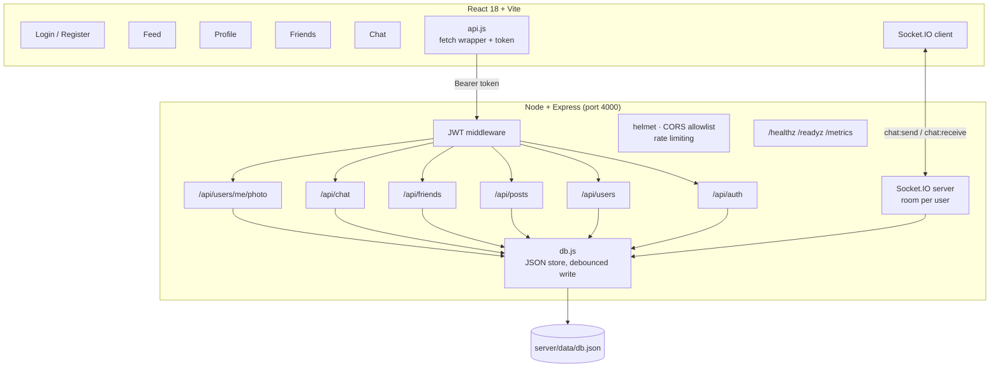

# ConnectHub

**A full-stack social network — auth, profiles, feed, friendships and real-time chat — built from scratch, containerised, and built to be operated.**

<p>
  <a href="https://github.com/dominicnkutha1-netize/ConnectHub/actions/workflows/ci.yml"></a>
  
  
  
  
  
  
</p>

<!--
  ⬜ TODO: add a screenshot here. Drop a PNG at docs/feed.png and uncomment.

  
-->

Every part of the application is hand-rolled: password hashing, token issuing,
file uploads, the data layer, and the WebSocket transport. No Firebase, no
Passport, no ORM. That was the point — I wanted to know what the frameworks
actually do before I let them do it for me.

The second half of the project is about running it: environment-driven config,
structured logs, liveness and readiness probes, Prometheus metrics, rate
limiting, graceful shutdown, a multi-stage container image that runs as
non-root, and a CI pipeline that tests, audits and smoke-tests the image.

---

## Contents

- [Features](#features)
- [Architecture](#architecture)
- [Tech stack](#tech-stack)
- [Quick start](#quick-start)
- [Running in Docker](#running-in-docker)
- [Deployment](#deployment)
- [Operating it](#operating-it)
- [Configuration](#configuration)
- [Testing](#testing)
- [API reference](#api-reference)
- [Data model](#data-model)
- [Design decisions](#design-decisions)
- [Known limitations](#known-limitations)
- [Roadmap](#roadmap)
- [License](#license)

---

## Features

| Area | What it does |
|---|---|
| 🔐 **Auth** | Register and log in with email + password. Passwords hashed with bcrypt, sessions carried by a 30-day JWT |
| 👤 **Profiles** | Editable name and bio; profile photo upload via multipart form (multer), served from `/uploads` |
| 📰 **Feed** | Create posts; the feed is scoped to you and your accepted friends |
| 👍 **Likes** | Like and unlike posts, with counts resolved server-side |
| 💬 **Comments** | Thread comments onto any post |
| 🤝 **Friendships** | Send, accept and decline requests; stranger suggestions; unfriend |
| ⚡ **Chat** | Real-time one-to-one messaging over Socket.IO, with per-user rooms and conversation history |
| 🚪 **Route guards** | Every page is wrapped in an auth check; unauthenticated visits redirect to `/login` |
| 🩺 **Operations** | Health/readiness probes, Prometheus metrics, JSON logs with request ids, rate limiting, graceful shutdown |

## Architecture



The API is a plain Express app mounted under `/api`, with one router file per
domain. Everything except `/api/auth/*` passes through the same JWT middleware,
which verifies the token once and attaches `req.userId` — so no route has to
re-implement authentication.

Real-time chat is deliberately separate from REST. The socket handshake carries
the same JWT; on connection the socket joins a room named `user_{id}`, and a
message is delivered by emitting to the recipient's room. That means one user
with three tabs open gets the message in all three, with no bookkeeping.

In production a single container serves the API, the WebSocket transport and the
built React client on one origin, so there is no CORS problem and one thing to
deploy.

## Tech stack

| Layer | Choice | Why |
|---|---|---|
| Frontend | React 18 + Vite | Fast HMR while iterating on UI |
| Routing | React Router 6 | Auth-guarded routes |
| Backend | Node.js + Express 4 | One router per domain, easy to reason about |
| Auth | JWT (30d) + bcryptjs | Stateless sessions, no server-side session store |
| Uploads | multer 2 | Multipart handling without a cloud dependency |
| Realtime | Socket.IO 4 | Automatic reconnection and room semantics |
| Storage | JSON file | Zero setup; single-user-scale by design |
| Logging | pino | Structured JSON, secret redaction built in |
| Metrics | prom-client | Prometheus-compatible `/metrics` |
| Security | helmet, express-rate-limit | Headers, CSP and brute-force protection |
| Packaging | Docker (multi-stage, non-root) | One artifact, same on every machine |
| CI | GitHub Actions | Tests on Node 20 and 22, client build, image smoke test |

## Quick start

Requires **Node 20 or newer**.

```bash
git clone https://github.com/dominicnkutha1-netize/ConnectHub.git
cd ConnectHub
```

**1. Start the API** (port 4000):

```bash
cd server
npm install
npm start
```

No secret file is needed for local development. If `JWT_SECRET` is not set, the
server generates a random key at boot and logs a warning — sessions are lost on
restart, which is fine locally and deliberately refused in production.

**2. Start the client** (port 3000), in a second terminal:

```bash
cd client
npm install
npm run dev
```

Open <http://localhost:3000>, register an account, then open a **private window**
and register a second account. Send a friend request from one, accept it in the
other, and the chat between them will update live.

Check it is alive:

```bash
curl http://localhost:4000/healthz
# {"status":"ok","uptime":3,"env":"development"}
```

## Running in Docker

One command builds the client, installs production dependencies, and produces a
single image that serves everything on port 4000.

```bash
cp .env.example .env
# put a real 32+ character secret in .env
node -e "console.log(require('crypto').randomBytes(32).toString('hex'))"

docker compose up --build
open http://localhost:4000
```

Or without Compose:

```bash
docker build -t connecthub .
docker run --rm -p 4000:4000 \
  -e JWT_SECRET="$(openssl rand -hex 32)" \
  -v connecthub-data:/app/server/data \
  connecthub
```

The image:

- uses a multi-stage build, so the final layer has no client build tools and no
  dev dependencies
- runs as an unprivileged `app` user, never root
- declares a `HEALTHCHECK` that hits `/healthz`
- keeps data in volumes, so recreating the container does not delete users

## Deployment

[`render.yaml`](render.yaml) is a Blueprint: point Render at this repository
and it builds the same Dockerfile, creates one free web service in Frankfurt,
and sets the environment variables. There is nothing to configure by hand.

The parts worth knowing:

- **One origin.** The container serves the API, the WebSocket transport and the
  built client, so there is no second service to deploy and no cross-origin
  traffic.
- **`JWT_SECRET` is generated by Render** and kept across deploys, so sessions
  survive a redeploy.
- **`CORS_ORIGINS` references the service's own URL** (`RENDER_EXTERNAL_URL`)
  instead of `*`, so the allowlist stays correct without being pasted in.
- **The health check is `/healthz`, not `/readyz`.** Failing liveness should
  restart the process; failing readiness should only drain traffic.

### The free tier, honestly

The free service sleeps after 15 minutes of inactivity and its filesystem is
ephemeral:

| Property | Consequence |
|---|---|
| ~1 minute cold start | The first request after a quiet period is slow |
| Disk wiped on sleep or redeploy | Accounts and posts do not survive; the store resets |
| 0.1 CPU, 512 MB RAM | Fine for a demo, not for a workload |

Because the store resets, [`server/seed.js`](server/seed.js) rebuilds a small
demo network on every boot — but **only when the store is empty** and
`SEED_DEMO` is set. It never touches a store that already has users, so it is
safe to leave enabled locally.

Demo credentials, also printed in the boot log:

```
email:    demo@connecthub.dev
password: connecthub-demo
```

The demo account is shared: anyone can post from it, and the data resets on the
next cold start. That is the tradeoff for a free URL.

### Deploying anywhere else

Nothing about the image is Render-specific. Any platform that runs a container
and injects `PORT` works:

```bash
docker build -t connecthub .
docker run -p 4000:4000 -e JWT_SECRET="$(openssl rand -hex 32)" connecthub
```

The only hard requirement in production is a `JWT_SECRET` of 32+ characters.
Without one the process refuses to start, rather than quietly logging every user
out on the next deploy.

## Operating it

### Probes

| Endpoint | Purpose | Expected |
|---|---|---|
| `GET /healthz` | Liveness. Is the process running? | `200` with uptime |
| `GET /readyz` | Readiness. Can it serve traffic? Checks the data store is writable | `200` ready, `503` degraded |
| `GET /metrics` | Prometheus scrape target | `200` text/plain |
| `GET /api/health` | Legacy check kept for the client | `200` |

Liveness and readiness are separate on purpose. A failing liveness probe should
restart the process; a failing readiness probe should only remove it from the
load balancer. Conflating them is how you get restart loops during a database
blip.

### Metrics

`/metrics` exposes:

- `connecthub_http_requests_total{method,route,status}`
- `connecthub_http_request_duration_seconds{method,route,status}` (histogram)
- `connecthub_process_*` and `connecthub_nodejs_*` from the default collector

Routes that do not match are labelled `unmatched` rather than by path, so a
scanner cannot create unbounded label cardinality.

### Logs

One JSON object per line, to stdout, ready for any log platform:

```json
{"level":30,"time":"2026-01-01T10:00:00.000Z","service":"connecthub","env":"production","req":{"id":"...","method":"POST","url":"/api/auth/login"},"res":{"statusCode":200},"responseTime":41,"msg":"request completed"}
```

Authorization headers, cookies and passwords are redacted before they are
written. Every response carries `x-request-id`, and an inbound `x-request-id` is
preserved so a request can be traced across services.

### Graceful shutdown

On `SIGTERM` or `SIGINT` the process:

1. stops accepting new connections,
2. disconnects sockets,
3. flushes the debounced write to disk,
4. exits `0`.

Without step 3, every deploy silently discards up to 150 ms of user activity.
A 10-second watchdog forces exit if something hangs.

### Rate limiting

`/api/auth/*` allows 20 requests per 15 minutes per IP, the rest of `/api`
allows 300 per minute. Probes and `/metrics` are never throttled. Configure with
`AUTH_RATE_MAX`, `AUTH_RATE_WINDOW_MS`, `API_RATE_MAX`, `API_RATE_WINDOW_MS`, or
set `RATE_LIMIT=off`.

## Configuration

Everything is environment-driven; see [`.env.example`](.env.example).

| Variable | Default | Notes |
|---|---|---|
| `NODE_ENV` | `development` | `production` requires `JWT_SECRET` and serves the built client |
| `PORT` | `4000` | |
| `JWT_SECRET` | — | **Required in production**, 32+ characters |
| `JWT_EXPIRES_IN` | `30d` | Any `jsonwebtoken` duration |
| `CORS_ORIGINS` | `*` | Comma-separated allowlist in production |
| `LOG_LEVEL` | `info` | `silent` in tests |
| `TRUST_PROXY` | `true` | Set `false` if exposed with no proxy |
| `DATA_DIR` | `server/data` | Where `db.json` lives |
| `UPLOADS_DIR` | `server/uploads` | Where photos are written |
| `MAX_UPLOAD_BYTES` | `5242880` | 5 MB |
| `BODY_LIMIT` | `100kb` | JSON body cap |
| `RATE_LIMIT` | `on` | `off` disables both limiters |
| `SEED_DEMO` | unset | Seeds a demo network into an empty store at boot |

The server refuses to start in production without a valid `JWT_SECRET`, rather
than falling back to a random key and quietly logging everyone out on each
deploy.

## Testing

```bash
cd server
npm test              # 36 tests, node:test + supertest
npm run test:coverage # same, with V8 coverage
```

The suite drives the real Express app over HTTP with supertest. Every test file
gets its own temporary data directory, so tests never touch a developer's
database and can run in parallel.

Covered today: auth (registration, normalisation, duplicate and weak-password
rejection, login, forged tokens), authorisation boundaries, the post lifecycle
(likes, comments, deletion, feed scoping), uploads (valid image, wrong type,
unauthenticated, no file), the demo seed (populates an empty store, is
idempotent, and the resulting account can log in and use every feature), and the
operational surface (probes, metrics, security headers, request ids, JSON 404s).

Not covered yet: the React client, and Socket.IO chat. Both are on the roadmap.

CI runs the suite on Node 20 and 22, builds the client, fails on high-severity
dependency advisories, then builds the Docker image, starts it, and asserts that
`/healthz`, `/readyz` and `/` respond and that the container is not running as
root.

## API reference

All routes are prefixed `/api` and require `Authorization: Bearer <token>`
except the auth routes.

**Auth** — `/api/auth`
| Method | Path | Purpose |
|---|---|---|
| POST | `/register` | Create an account, returns `{ token, user }` |
| POST | `/login` | Authenticate, returns `{ token, user }` |

**Users** — `/api/users`
| Method | Path | Purpose |
|---|---|---|
| GET | `/me` | Current user from the token |
| GET | `/:id` | Public view of another user |
| PUT | `/me` | Update name / bio |
| POST | `/me/photo` | Upload a profile photo (`multipart/form-data`, field `photo`) |

**Posts** — `/api/posts`
| Method | Path | Purpose |
|---|---|---|
| GET | `/` | Feed for the current user (self + friends) |
| GET | `/user/:id` | Posts by one user |
| POST | `/` | Create a post |
| POST | `/:id/like` | Toggle like |
| POST | `/:id/comment` | Add a comment |
| DELETE | `/:id` | Delete own post |

**Friends** — `/api/friends`
| Method | Path | Purpose |
|---|---|---|
| GET | `/` | Accepted friends |
| GET | `/requests` | Incoming friend requests |
| GET | `/suggestions` | Users you're not connected to |
| POST | `/:id/request` | Send a request |
| POST | `/:id/accept` | Accept a request |
| POST | `/:id/decline` | Decline a request |
| POST | `/:id/unfriend` | Remove a friend |

**Chat** — `/api/chat`
| Method | Path | Purpose |
|---|---|---|
| GET | `/conversations` | Everyone you've messaged |
| GET | `/with/:id` | Message history with one user |

**Socket events**
| Direction | Event | Payload |
|---|---|---|
| client → server | `chat:send` | `{ toId, content }` |
| server → recipient | `chat:receive` | message object |
| server → sender | `chat:sent` | message object (server-assigned id) |

## Data model

Six collections in `server/data/db.json`:

```
users        id, name, email, passwordHash, bio, photo, createdAt
posts        id, userId, content, createdAt
comments     id, postId, userId, content, createdAt
likes        id, postId, userId
friendships  id, fromId, toId, status(pending|accepted), createdAt
messages     id, fromId, toId, content, createdAt
```

Writes are debounced 150 ms and flushed once, so a burst of socket messages does
not rewrite the file per message. Writes are atomic (temp file + rename), so a
crash mid-write cannot corrupt the store. IDs are allocated with a max-plus-one
scan.

## Design decisions

**A JSON file instead of a database.** Deliberate. The goal was to implement
auth, relationships and persistence with nothing hiding the mechanics. It is the
first thing I would replace for anything real — see the roadmap.

**Two transports, not one.** REST for request/response, WebSocket only for what
needs to be pushed. Trying to do chat over polling was the first version, and it
was both slower and more code.

**Server-assigned message IDs.** The client sends `chat:send` and waits for
`chat:sent` to render. Optimistic rendering would feel faster and would need
reconciliation on failure — a tradeoff I would revisit.

**Auth state in a React context, not a store.** There are exactly three pieces of
global state (user, role, logout). A store would be a dependency earning nothing.

**Fail fast on configuration.** A missing production secret crashes at boot with
instructions, instead of starting in a state that will silently log users out on
the next deploy.

## Known limitations

Honest list, because a project that claims to have no weaknesses has not been
looked at hard enough.

- **JWT in `localStorage`** — readable by any injected script. `httpOnly` cookies
  with CSRF protection is the correct design, and is next on the roadmap.
- **No horizontal scaling.** The JSON store is not shared between replicas, so
  the service runs as a single instance by design.
- **The public demo is ephemeral.** It runs on a free tier that wipes the disk
  when it sleeps, so data resets. That is why it re-seeds itself on boot.
- **No pagination** anywhere; the feed loads everything.
- **Client and Socket.IO have no automated tests** — the API does.
- **Rate limiting is per-process and in-memory**, so it needs Redis once there is
  more than one replica.

## Roadmap

1. ✅ **Tests** — 36 API tests with `node:test` + supertest, run in CI.
2. ✅ **Operability** — probes, metrics, structured logs, graceful shutdown,
   Docker image, CI pipeline.
3. ✅ **Deployment** — one container on Render via a Blueprint, with a demo seed
   that survives the free tier's ephemeral disk.
4. **PostgreSQL + Prisma** — real schema, migrations, foreign keys, connection
   pooling. The JSON store was the point of the exercise; it is also the first
   thing to replace.
5. **`httpOnly` cookie sessions** + CSRF token, replacing `localStorage`.
6. **Pagination** on the feed and message history.
7. **Client tests** — React Testing Library on the auth and feed flows.
8. **Observability** — a Grafana dashboard and alert rules on top of `/metrics`.

## License

MIT — see [LICENSE](LICENSE). © 2026 Dominic Nkutha
